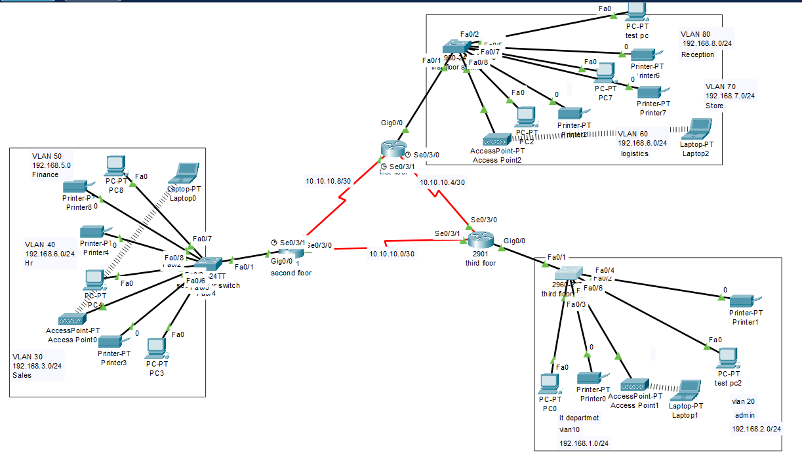

# Cisco Packet Tracer Labs

Three network design and implementation exercises built in **Cisco Packet Tracer**, covering addressing/subnetting, VLANs, inter-VLAN routing, DHCP, OSPF, SSH and port security.

| # | Lab | Main topics |
|---|-----|-------------|
| 1 | Accounts & Delivery departments | Subnetting, 2 routers, 2 switches, connectivity test |
| 2 | XYZ company branch network | VLANs, router-on-a-stick, DHCP, Wi-Fi |
| 3 | Vic Modern Hotel network | 3 routers, serial links, OSPF, DHCP, SSH, port security |

---

## Lab 1 — Accounts & Delivery Departments

**Goal:** connect the ACCOUNTS and DELIVERY departments using the network `192.168.40.0`.

**Requirements**
- At least 2 PCs per department
- Appropriate number of switches and routers
- All interfaces configured with IP address, subnet mask and gateway (from `192.168.40.0`)
- Correct cabling for every link
- PCs in DELIVERY must be able to ping PCs in ACCOUNTS

**Design**

| Segment | Network | Gateway |
|---------|---------|---------|
| ACCOUNTS | 192.168.40.0/26 | 192.168.40.1 |
| DELIVERY | 192.168.40.64/26 | 192.168.40.65 |
| Router ↔ Router link | 192.168.40.128/30 | .129 / .130 |

- 1 switch + 1 router per department, routers linked together
- Cables: copper straight-through (PC–switch, switch–router), copper cross-over (router–router)
- Verification: `ping` from a DELIVERY PC to an ACCOUNTS PC

---

## Lab 2 — XYZ Company Branch Network

**Goal:** design the network of a new branch, separate from the HQ network, using the ISP base network `192.168.1.0`.

**Requirements**
- 1 Cisco router + 1 Cisco switch
- 3 departments: Admin/IT, Finance/HR, Customer Service/Reception
- Each department in its own VLAN
- Wireless network for each department
- Hosts obtain IPv4 addresses automatically (DHCP)
- All departments can communicate with each other

**Design**

| Department | VLAN | Network | Gateway |
|------------|------|---------|---------|
| Admin/IT | 10 | 192.168.1.0/26 | 192.168.1.1 |
| Finance/HR | 20 | 192.168.1.64/26 | 192.168.1.65 |
| Customer Service/Reception | 30 | 192.168.1.128/26 | 192.168.1.129 |

- **Router-on-a-stick**: one trunk link switch → router, one 802.1Q sub-interface per VLAN (`Gig0/0.10`, `.20`, `.30`)
- **DHCP pools** on the router, one per VLAN
- One access point per VLAN for Wi-Fi

```text
interface g0/0.10
 encapsulation dot1Q 10
 ip address 192.168.1.1 255.255.255.192
!
ip dhcp pool ADMIN_IT
 network 192.168.1.0 255.255.255.192
 default-router 192.168.1.1
```

---

## Lab 3 — Vic Modern Hotel Network

**Goal:** design and implement the network of a three-floor hotel.

**Requirements**
1. Three routers, one per floor, all placed in the IT server room
2. Routers interconnected with **serial DCE** cables
3. Router links: `10.10.10.0/30`, `10.10.10.4/30`, `10.10.10.8/30`
4. One switch per floor
5. Wi-Fi on every floor (laptops and phones)
6. One printer per department
7. One VLAN per department (table below)
8. **OSPF** as routing protocol
9. **DHCP** for all devices, each router acts as DHCP server
10. All devices can reach each other
11. **SSH** on all routers
12. `Test-PC` on `fa0/1` of the IT switch to test remote login
13. **Port security** on the IT switch: only `Test-PC` on `fa0/1` (sticky MAC, violation mode `shutdown`)

**VLAN and addressing plan**

| Floor | Department | VLAN | Network |
|-------|------------|------|---------|
| 1st | Reception | 80 | 192.168.8.0/24 |
| 1st | Store | 70 | 192.168.7.0/24 |
| 1st | Logistics | 60 | 192.168.6.0/24 |
| 2nd | Finance | 50 | 192.168.5.0/24 |
| 2nd | HR | 40 | 192.168.4.0/24 |
| 2nd | Sales | 30 | 192.168.3.0/24 |
| 3rd | Admin | 20 | 192.168.2.0/24 |
| 3rd | IT | 10 | 192.168.1.0/24 |

**Router links (serial DCE)**

| Link | Network |
|------|---------|
| Second floor ↔ Third floor | 10.10.10.0/30 |
| First floor ↔ Third floor | 10.10.10.4/30 |
| First floor ↔ Second floor | 10.10.10.8/30 |

**Topology**



**Key configuration**

```text
! OSPF (example for one router)
router ospf 1
 network 10.10.10.0 0.0.0.3 area 0
 network 192.168.1.0 0.0.0.255 area 0

! SSH
hostname ROUTER
ip domain-name hotel.local
crypto key generate rsa
ip ssh version 2
username admin secret <password>
line vty 0 4
 login local
 transport input ssh

! Port security on the IT switch
interface fa0/1
 switchport mode access
 switchport port-security
 switchport port-security mac-address sticky
 switchport port-security violation shutdown
```

**Verification**
- `show ip route` — OSPF routes (`O`) learned from the other floors
- `show ip ospf neighbor` — neighbors in FULL state
- `ping` between departments on different floors
- `ssh -l admin <router-ip>` from `Test-PC`
- `show port-security interface fa0/1` — sticky MAC learned

---

## Tools

- Cisco Packet Tracer
- Cisco 2901 routers, Cisco 2960 switches, access points, PCs, laptops, printers

## How to open

Open the `.pkt` file of each lab in Cisco Packet Tracer.
